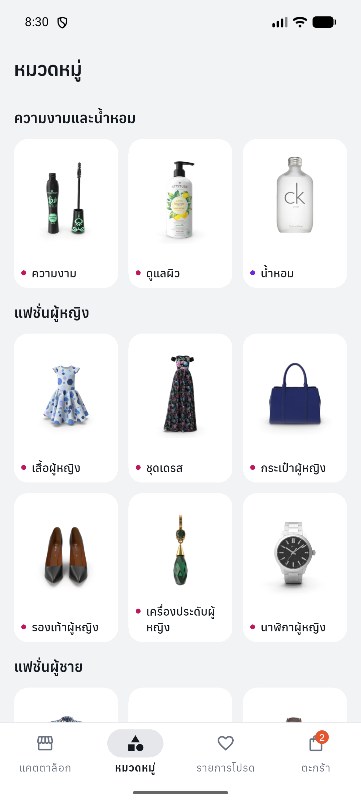

# Product Catalog (Flutter)

A Flutter shopping catalog backed by the real [DummyJSON products API](https://dummyjson.com/docs/products).
It has a product list with search, category filters, sorting and pagination,
a detailed product page, a wishlist and a cart saved on the device. State is managed with
**Riverpod**, HTTP is done with **Dio**, and the layout adapts to phones and
tablets. UI text and built-in Material/Cupertino controls use Thai. Category
names and the API's shipping, warranty and return-policy phrases are
translated to Thai; product titles, descriptions, brands and reviews are shown
as the API returns them.

| Catalog | Search | Categories | Product detail | Cart |
|---|---|---|---|---|
|  |  |  |  |  |

| Tablet portrait (4 columns) | Tablet landscape (two-pane detail) |
|---|---|
|  |  |

Screenshots were captured on 27 October 2026 from the Android debug build
of application source `00da610` on an Android 17 (API 37) emulator. Tablet
sizes (800×1280 dp and 1280×800 dp) were set with `adb shell wm size/density`.
Live API products, prices, stock and totals may change.

## Design

A clean, modern retail look rather than a default Material demo. It is
defined once in `lib/core/theme/app_theme.dart`:

- **Palette**: a light grey page with white cards, fields, chips and bars;
  near-black ink for text, selected chips, tab indicators and focus. Deep
  green is reserved for buy actions (add to cart). A coral accent marks
  discounts and savings; amber is used for ratings and orange for low stock.
  Light and dark themes share the same tokens. `CatalogColors` (a
  `ThemeExtension`) holds the retail-specific colours.
- **Category colours**: `CategoryPalette` gives each category a tint and a
  text colour from an 8-hue table, so products from different categories are
  easy to tell apart (category name on cards, category pill on the detail
  page, dots on the Categories tab). Reviewer avatars use the same palette.
- **Surfaces**: flat white cards on the grey page, no shadows. Product photos
  sit whole (`BoxFit.contain`) and are multiplied onto their tile so white
  photo backgrounds blend in.
- **Shape and spacing**: pill buttons, chips and badges; 12 dp thumbnails and
  controls; 16 dp cards. Spacing uses a 4/8/12/16/24/32 scale (`AppSpace`,
  `AppRadius`).
- **Type**: [Anuphan](https://fonts.google.com/specimen/Anuphan), a Thai/Latin
  variable font bundled in `assets/fonts/` (SIL Open Font License, see
  `assets/fonts/anuphan-OFL.txt`). Prices, quantities and totals use tabular
  figures. Colour appears only where it carries meaning: discounted prices,
  "only N left" and out of stock. Normal stock text stays neutral.
- **Components**: filter chips without checkmarks; a sort control that shows
  the current order and changes its fill and border while open; detail
  information in white cards and stacked sections instead of tabs; cart lines
  grouped in one card with dividers.

## Requirements checklist

| # | Requirement | Where |
|---|---|---|
| 1 | List shows image, name, price | `products/presentation/widgets/product_card.dart` |
| 2 | Tap opens product detail | `ProductDetailScreen.open(context, productId)` |
| 3 | Riverpod | `productListProvider` (AsyncNotifier), `productDetailProvider` (FutureProvider.family), `catalogQueryProvider`, `categoriesProvider`, `cartProvider`, `wishlistProvider`, plus `dioProvider` / `productRepositoryProvider` |
| 4 | Dio | `products/data/product_repository.dart` (`DioProductRepository`) |
| 5 | Loading / Error / Empty | Skeleton grid on first load; skeleton category covers; separate states for Load More, Refresh, Detail and Categories; empty states that match search / category |
| 6 | Pull-to-refresh | `RefreshIndicator` + `AlwaysScrollableScrollPhysics` (works on empty and error states too) |
| 7 | Pagination / Load More | "โหลดเพิ่มเติม" button with spinner, Retry, page counter and progress bar |
| 8 | Mobile and tablet | Columns from real width (1–4), content max 1200 dp, navigation rail and two-pane detail from 840 dp |
| 9 | UI / State / Repository split | `presentation/` / `application/` / `data/` in each feature |
| 10 | No hardcoded products | Everything comes from the API; fake data exists only under `test/` |

### Extra features

- **Search** with a 400 ms debounce (`/products/search`), **category chips**,
  and **sorting** by price, rating or name (`sortBy` / `order`)
- **Categories tab** (`/products/categories`): categories grouped into
  departments (beauty, women's and men's fashion, phones and computers, home
  and kitchen, sports and travel; new API categories go under "หมวดอื่น ๆ").
  Each tile shows a photo of one of its products, fetched with
  `/products/category/{slug}?limit=1`. Covers load only once the tab is open,
  show a skeleton until the photo arrives, and fall back to the category's
  icon on its tint when there is no photo or the request fails.
  - Price sorting is explicitly labelled **ราคาปกติ** (list price), because
    the API sorts its `price` field before per-product discounts. Displayed
    sale prices can therefore differ from list-price order.
- **Product cards**: discount badge, rating and coloured category name, sale
  and list price, stock level (low stock / out of stock), wishlist heart and
  a round add-to-cart button
- **Product detail**: swipeable gallery with thumbnails and page counter;
  category pill and brand, rating with review count; savings; quantity
  picker; a card with stock, shipping, warranty and return policy; then
  sections for the description, specifications (including SKU) and reviews;
  primary "ใส่ตะกร้า" and secondary "ดูตะกร้า" (viewing the cart never adds
  more units)
- **Wishlist** and **cart** saved locally: quantity is limited by stock,
  totals use the discounted price, and the cart count shows as a badge on
  the tab
- **Cart recovery**: removing a line shows "เลิกทำ" and restores its saved
  quantity and position. A later removal, clearing the cart, or re-adding the
  same product prevents an older Undo from overwriting the current cart.
- **Readable cards**: two reserved title lines, 12/14/16 dp metadata/title/price
  scale, full-width prices and a compact stock/actions row. Normal stock reads
  "มีสินค้า" on cards; low stock and the detail page retain exact quantities.
  Cart remove/quantity controls keep 48 dp touch targets with compact visuals.
  An empty wishlist includes "เลือกดูสินค้า" to return to the catalog.

## Versions

| Tool | Version |
|---|---|
| Flutter | 3.41.0 (stable) |
| Dart | 3.11.0 (`pubspec.yaml` requires ^3.10.7) |
| flutter_riverpod / riverpod | 3.3.2 |
| dio | 5.11.1 |
| intl | 0.20.2 (pinned by Flutter localizations) |
| shared_preferences | 2.5.5 |
| cached_network_image | 3.4.1 |

Exact dependency versions are pinned in `pubspec.lock`.

## Getting started

```bash
flutter pub get
flutter run            # pick an Android device or emulator
```

Run the checks:

```bash
dart format --output=none --set-exit-if-changed lib test
flutter analyze
flutter test
flutter build apk --debug     # development build; no release credentials needed
```

Tests use a fake repository and a fake Dio adapter, so they need no internet.

### Android release signing

Release builds use your upload keystore, following the
[Flutter Android signing guide](https://docs.flutter.dev/deployment/android#sign-the-app).
They never fall back to a debug key.

1. Create or obtain your upload keystore as described in the guide.
2. Copy `android/key.properties.example` to `android/key.properties` and
   replace the path, alias and passwords with your own values. Use forward
   slashes in Windows paths; relative paths start in the `android/` directory.
3. Run `flutter build apk --release` or `flutter build appbundle --release`.

The APK is written to `build/app/outputs/flutter-apk/app-release.apk`.
Missing signing properties or a missing keystore stop the release build with
an actionable error. Debug builds remain available without those files.
`android/key.properties` and keystore files are already excluded from Git.

## Architecture

```
lib/
  main.dart                       restore device storage, ProviderScope (automatic retry disabled)
  app.dart                        Thai MaterialApp, Material 3 light/dark theme
  core/
    theme/app_theme.dart          colours, category palette, spacing, radii, Anuphan font
    errors/app_exception.dart     error types + user-facing (Thai) messages
    network/dio_provider.dart     shared Dio (10 s connect / 15 s receive timeout)
    riverpod/no_retry.dart        disables Riverpod 3 automatic retry
    formatting/price_format.dart
    storage/                      saved shopping collections and storage issue notice
  features/
    products/
      data/                       Product, ProductCategory, CatalogQuery, ProductPage, ProductRepository, Thai labels
      application/                catalog query, categories and their covers, product list (pagination), product detail
      presentation/               catalog screen, detail screen, widgets (card, grid, labels, skeleton)
    categories/presentation/      Categories tab (departments and cover tiles)
    wishlist/{application,presentation}/
    cart/{application,presentation}/
    home/{application,presentation}/  tab state + shell (bottom bar / navigation rail)
```

Flow: **UI → Riverpod providers → ProductRepository → Dio → REST API**

- **UI** only renders state and forwards user actions; it never touches Dio.
- **State**: `productListProvider` *watches* `catalogQueryProvider`. Changing
  the search, category or sort rebuilds the list from page one, and the
  previous request is cancelled.
  `catalogSearchProvider` owns the editable search draft and its debounce.
  Selecting a category from any screen cancels pending input, even when
  reselecting the same category; changing sort preserves pending input.
- **Repository** picks the endpoint (`/products`, `/products/search`,
  `/products/category/{slug}`; a category cover asks that endpoint for one
  product's `thumbnail` and `images`), validates the JSON, and turns every failure
  into an `AppException` (`timeout`, `network`, `notFound`, `server`,
  `invalidData`, `cancelled`). Users never see raw exceptions.
- **Device storage**: `main()` loads the cart and wishlist with
  `SharedPreferencesAsync` before starting the app. Providers restore full
  product snapshots from versioned JSON collections; duplicate IDs are
  removed/merged and cart quantities are clamped to saved stock. Saves are
  queued in order so an older write cannot overwrite a later edit or removal.
  Individual corrupt records are skipped. Failed reads are never overwritten
  with an empty collection; unavailable storage and failed writes show a
  dismissible notice. Isolated ProviderScopes use an in-memory store unless
  explicitly overridden, so widget/unit fixtures need no platform plugins.
- **Images**: `CachedNetworkImageProvider` uses the device's cache directory.
  `ResizeImagePolicy.fit` decodes images to their actual layout size and pixel
  density, capped at 2048 pixels per axis, preserving the source aspect ratio.
  Missing/failed images keep the existing placeholder; fades respect reduced
  motion. Disk caching is for native platforms; the package's web provider
  does not persist image files.
- **Thai labels**: `products/data/thai_labels.dart` maps the 24 known
  category slugs to Thai names and rewrites the API's fixed shipping,
  warranty and return-policy phrases (for example "Ships in 3-5 business
  days" → "จัดส่งภายใน 3–5 วันทำการ"). Unknown categories keep the API's name
  and unrecognised phrases are shown unchanged.
- Dio and the repository are provided through Riverpod, so tests replace them
  with `overrideWithValue`.

### Data rules

- `id` (int), `title` (non-empty string) and `price` (non-negative number) are
  required. If any is missing or has the wrong type, the **whole response is
  rejected** with an "invalid data" error. Products are never silently
  skipped, and no price is replaced with 0.
- Everything else is optional and shown as "unknown" when missing, never
  invented. Examples: no brand line, no stock label, "ไม่ระบุ" for a missing
  warranty, a placeholder image. Malformed reviews are skipped.
- **Price**: the API's `price` is the list price. Sale price =
  `price × (1 − discountPercentage / 100)`, rounded to cents per unit.
  The discount badge uses `discountPercentage.round()` and appears when
  that integer is greater than zero: 0.6% displays as 1%, while a discount
  that rounds to 0 has no badge. This unit-price calculation does not
  guarantee equality with the API's aggregate `discountedTotal`.
- The API can't combine search and category in one request. Choosing a
  category clears the search, and typing a search covers all categories.

## Pagination and refresh

The API takes `limit` / `skip` and returns `{products, total, skip, limit}`.

1. Page size is 20, starting at skip 0.
2. `nextOffset = requestOffset + rawItemCount`, counted **before**
   de-duplication. A duplicate ID therefore never shifts the cursor.
3. `hasMore = rawItemCount > 0 && nextOffset < total`. The footer shows
   "หน้า X จาก Y • โหลดแล้ว N จาก T รายการ" plus a progress bar.
4. Load More is ignored while a Load More, a Refresh or a query reload is
   running. On failure the cursor does not move, so Retry asks for the same
   offset again.
5. Items are appended only if their ID is not already in the list.

**Stale requests.** Each build and each refresh increments a *generation*
counter. A build's `onDispose` marks the notifier as disposed and cancels its
`CancelToken`s. Every request records the generation it started with. Its
success, error and cleanup paths only write state if the notifier is not
disposed and the generation is still current. A slow Load More from before a
Refresh or a query change can therefore never add stale items, move the
cursor, or switch off the new request's spinner. (Riverpod 3's `ref.mounted`
alone did not catch this case; a test covers it.)

**Refresh semantics.**
- The current items stay on screen while refreshing.
- On success the first page replaces the list and the cursor is reset.
- On failure the old items, cursor and `hasMore` are kept, a SnackBar shows
  once for that request, and Load More continues from the old cursor.
- Concurrent refresh calls share one Future, and that Future always
  completes, so the `RefreshIndicator` never spins forever.

**Lifecycle.**
- The list, query, cart and wishlist providers live at the root scope.
- The shell uses an `IndexedStack`, so each tab keeps its scroll position and
  search text. Hidden tabs have tickers disabled.
- Opening a product and coming back keeps the list and the scroll position,
  with no reload.
- `productDetailProvider` is `autoDispose.family` by ID. Leaving the page
  cancels only that request.
- Riverpod's automatic retry is off. Failures show an explicit Retry button.

## Responsive layout

| Available width | Behaviour |
|---|---|
| Any | 16 dp side padding, 12 dp gaps, 1–4 columns computed from the real width with a target minimum card width of 150 dp |
| ≥ 840 dp | Navigation rail instead of the bottom bar; detail page shows gallery and info side by side |
| > 1200 dp | Content centred and capped at 1200 dp |

Card height grows with the current text scale. Titles reserve two lines;
titles, metadata, prices and stock labels use line limits and ellipsis where
applicable. The struck-through list price appears only when it fits beside
the sale price. Arbitrary text lengths, prices and text scales can still
truncate content. Existing widget tests target overflow on the catalog,
detail and cart screens at 360×800, 800×1280 and 1280×800 with text scale
1.0 and 1.5.

## Testing

On application source `00da610`, `flutter analyze` reports no issues and
`flutter test` passes all 110 tests (Flutter 3.41.0).

The tests cover:

- **Model**: every field, sale price and discount rounding, defaults for
  missing fields, out of stock, image URL filtering, skipping malformed
  reviews, rejecting a bad id/title/price, category parsing.
- **Thai labels**: category names with fallback; shipping ranges, single
  amounts and overnight; warranty and return-policy amounts and special
  cases; unrecognised text left unchanged.
- **Repository** (fake Dio adapter):
  - endpoints and query parameters for list, search, category and sort;
  - cursor and `hasMore` from `total`; an empty page ends pagination;
  - malformed envelopes;
  - 404 → not found on detail, but server error on the list;
  - timeout, network and invalid-JSON mapping; cancellation; categories;
  - category covers: thumbnail, first image or none, malformed responses.
- **State**:
  - first page, empty result, append with duplicates, end of pagination;
  - Load More guard and retry at the same offset;
  - refresh success, failure and sharing;
  - stale Load More after a refresh or a query change;
  - a new query reloads from 0; Load More and Refresh use the current query;
  - a failed reload never acts on the previous query's items;
  - cart merge, stock limits, totals, remove and clear; wishlist toggle;
  - search / category rules.
- **Widgets**:
  - skeleton → data, error + Retry, pull-to-refresh on error and empty
    states, refresh error shown once;
  - Load More spinner and Retry;
  - debounced search and clearing it; category chips and sort; the
    Categories tab, covers loading only once it is open, and the cover
    skeleton giving way to the fallback icon;
  - category selection (including the active category) cancels pending
    search; sorting keeps the draft; clearing or disposing cancels its timer;
  - add to cart from a card with the badge updating; removing from the cart;
    the wishlist;
  - opening the right product and returning to the same scroll position;
    the detail sections and Thai policy text; quantity, Add to cart and opening the cart with the stock limit;
    out of stock; detail Retry; "not found" with Back;
  - the overflow matrix above.

### Verification record

- **Current source (`00da610`)**: `flutter analyze`, all 110 tests and the
  Android debug x64 build passed. Catalog, search, Categories, product detail
  and cart were manually inspected with the debug build on an Android 17 /
  API 37 emulator against the live API, in phone and tablet layouts.
- **Historical release check**: earlier project notes record a release-APK
  check against the live API on a Pixel 8 emulator (Android 16 / API 36):
  catalog, search "phone", product detail, add to cart, wishlist heart and
  cart totals.
  Tablet sizes 800×1280 dp and 1280×800 dp were set with
  `adb shell wm size/density`. The checked commit and date were not recorded;
  this is not verification of the current release APK.
- **Not tested**: iOS (no macOS/Xcode available), physical devices, and
  switching the network off on the emulator mid-request. Unit and widget
  tests simulate network failures instead.

## Assumptions and limitations

- **Currency**: the API has no currency field, so prices are shown as USD with
  two decimals. No conversion is done.
- **Units**: the API gives size and weight without units, so the numbers are
  shown as-is.
- Cart and wishlist are saved on this device and restored after restarting.
  Saved products are snapshots: prices and stock can differ from later API
  responses. Preferences store convenience data, not orders or payment
  records; uninstalling the app or clearing its data removes them. There is
  **no checkout**; the detail page separates adding items from viewing the cart.
- The mockup's colour variants, installment and "100% genuine" badges, and
  Profile tab are not built: the API has no data for them and there is no
  login.
- DummyJSON is a public test service whose data can change, so nothing
  depends on specific IDs or counts.

## Possible improvements

- Revalidate saved product prices/stock against the API, and add checkout
  behind a real backend
- Infinite scroll alongside the Load More button
- A full-screen zoomable gallery
- Integration tests on a device (`integration_test`) and CI
