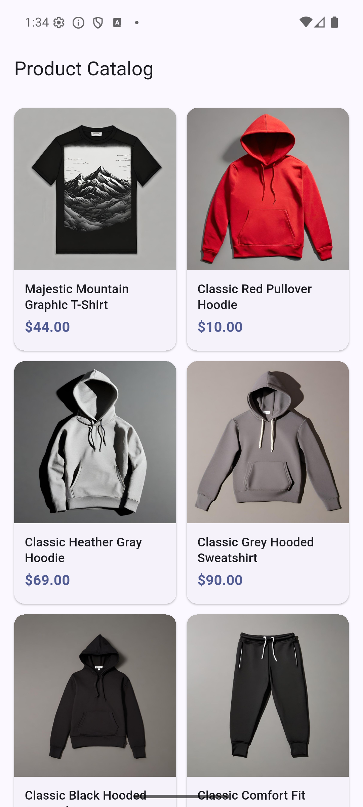
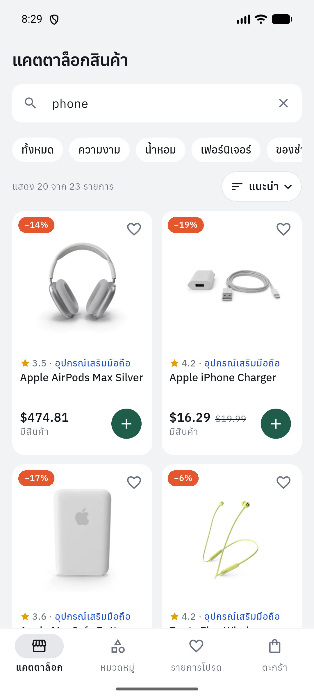
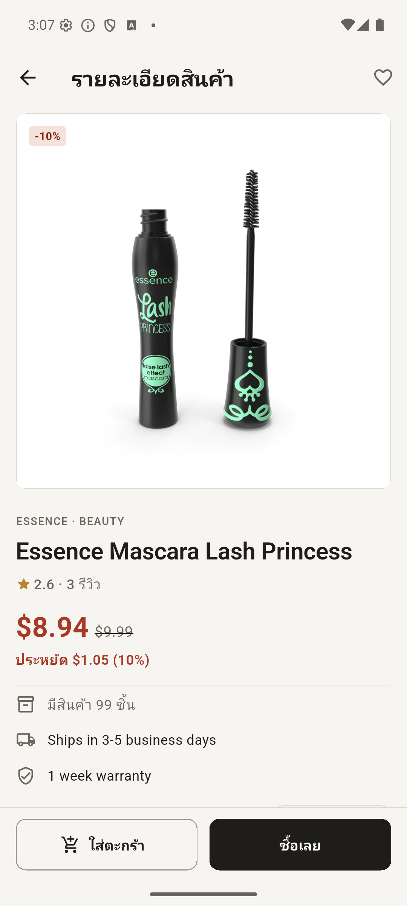
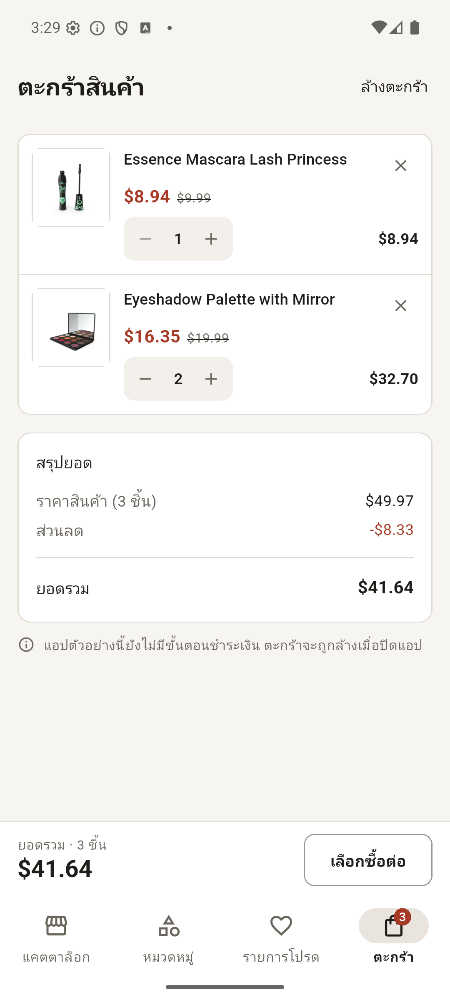
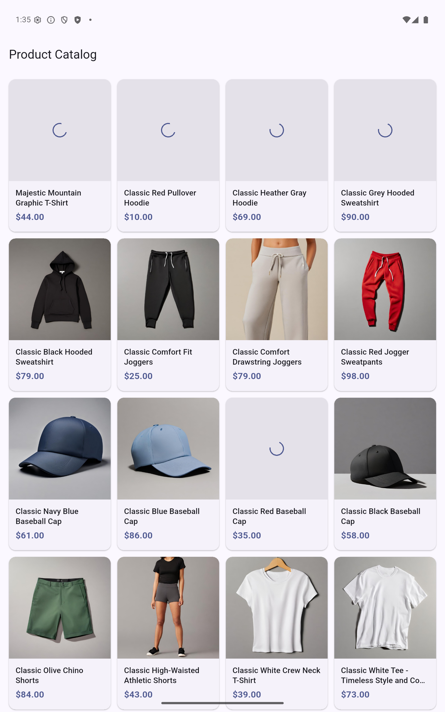
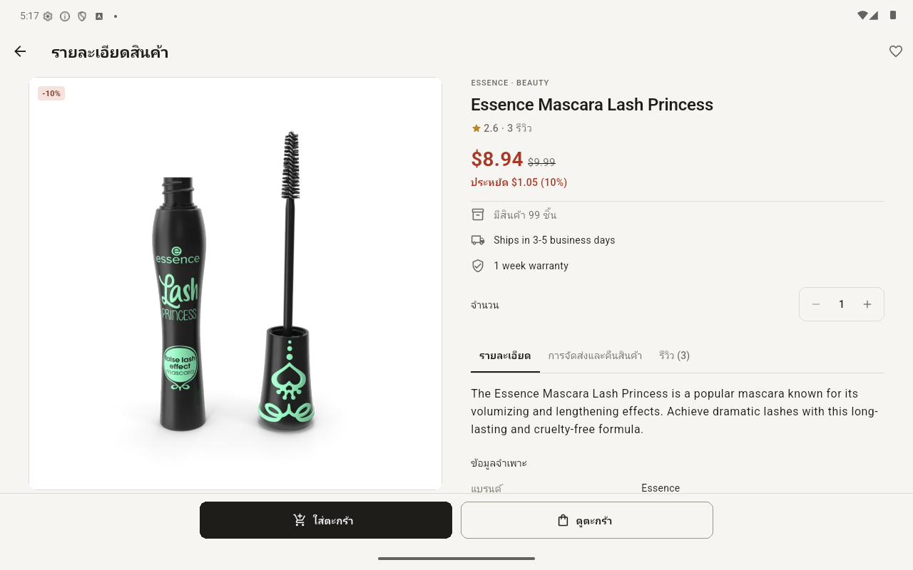

# Product Catalog (Flutter)

A Flutter shopping catalog backed by the real [DummyJSON products API](https://dummyjson.com/docs/products).
It has a product list with search, category filters, sorting and pagination,
a detailed product page, a wishlist and a local cart. State is managed with
**Riverpod**, HTTP is done with **Dio**, and the layout adapts to phones and
tablets. UI text is Thai; product data is shown as the API returns it.

| Catalog | Search | Product detail | Cart |
|---|---|---|---|
|  |  |  |  |

| Tablet portrait (4 columns) | Tablet landscape (navigation rail, two-pane detail) |
|---|---|
|  |  |

## Design

The visual direction is a calm retail catalogue rather than a default
Material demo. It is defined once in `lib/core/theme/app_theme.dart`:

- **Palette**: warm "paper" background, near-black "ink" for text and primary
  buttons, and a single brick-red accent reserved for sale prices,
  discounts and low stock. Light and dark themes share the same tokens.
  `CatalogColors` (a `ThemeExtension`) holds the retail-specific colours.
- **Surfaces**: flat. Cards, the gallery and lists use 1 px hairline borders
  instead of shadows. Product photos sit whole (`BoxFit.contain`) on white
  tiles instead of being cropped.
- **Shape and spacing**: a small corner-radius scale (4 badge · 8 thumbnail ·
  10 control · 12 card) and a 4/8/12/16/24 spacing scale (`AppSpace`,
  `AppRadius`).
- **Type**:
  - uppercase, letter-spaced category and brand labels;
  - tabular figures for prices, quantities and totals;
  - colour only where it carries meaning — discounted prices, and "only N
    left" / out of stock. Normal stock text stays neutral.
- **Components**: ink filter pills without checkmarks; text tabs with an
  underline on the detail page; two-column spec tables with hairline rows;
  cart lines separated by dividers instead of nested cards.

## Requirements checklist

| # | Requirement | Where |
|---|---|---|
| 1 | List shows image, name, price | `products/presentation/widgets/product_card.dart` |
| 2 | Tap opens product detail | `ProductDetailScreen.open(context, productId)` |
| 3 | Riverpod | `productListProvider` (AsyncNotifier), `productDetailProvider` (FutureProvider.family), `catalogQueryProvider`, `categoriesProvider`, `cartProvider`, `wishlistProvider`, plus `dioProvider` / `productRepositoryProvider` |
| 4 | Dio | `products/data/product_repository.dart` (`DioProductRepository`) |
| 5 | Loading / Error / Empty | Skeleton grid on first load; separate states for Load More, Refresh, Detail and Categories; empty states that match search / category |
| 6 | Pull-to-refresh | `RefreshIndicator` + `AlwaysScrollableScrollPhysics` (works on empty and error states too) |
| 7 | Pagination / Load More | "โหลดเพิ่มเติม" button with spinner, Retry, page counter and progress bar |
| 8 | Mobile and tablet | Columns from real width (1–4), content max 1200 dp, navigation rail and two-pane detail from 840 dp |
| 9 | UI / State / Repository split | `presentation/` / `application/` / `data/` in each feature |
| 10 | No hardcoded products | Everything comes from the API; fake data exists only under `test/` |

### Extra features

- **Search** with a 400 ms debounce (`/products/search`), **category chips**
  and a **Categories tab** (`/products/categories`), and **sorting** by price,
  rating or name (`sortBy` / `order`)
  - Price sorting is explicitly labelled **ราคาปกติ** (list price), because
    the API sorts its `price` field before per-product discounts. Displayed
    sale prices can therefore differ from list-price order.
- **Product cards**: discount badge, rating, sale and list price, stock level
  (low stock / out of stock), wishlist heart and add-to-cart button
- **Product detail**: swipeable gallery with thumbnails and page counter;
  brand, category, SKU, rating with review count, and warranty; savings;
  stock and shipping; quantity picker; tabs for details/specs,
  shipping & returns, and reviews; "Add to cart" and "Buy now"
- **Wishlist** and **cart** held in memory: quantity is limited by stock,
  totals use the discounted price, and the cart count shows as a badge on
  the tab

## Versions

| Tool | Version |
|---|---|
| Flutter | 3.38.7 (stable) |
| Dart | 3.10.7 |
| flutter_riverpod / riverpod | 3.3.2 |
| dio | 5.11.1 |
| intl | 0.20.3 |

Exact dependency versions are pinned in `pubspec.lock`.

## Getting started

```bash
flutter pub get
flutter run            # pick an Android device or emulator
```

Run the checks:

```bash
dart format --output=none --set-exit-if-changed lib test
flutter analyze
flutter test
flutter build apk --debug     # development build; no release credentials needed
```

Tests use a fake repository and a fake Dio adapter, so they need no internet.

### Android release signing

Release builds use your upload keystore, following the
[Flutter Android signing guide](https://docs.flutter.dev/deployment/android#sign-the-app).
They never fall back to a debug key.

1. Create or obtain your upload keystore as described in the guide.
2. Copy `android/key.properties.example` to `android/key.properties` and
   replace the path, alias and passwords with your own values. Use forward
   slashes in Windows paths; relative paths start in the `android/` directory.
3. Run `flutter build apk --release` or `flutter build appbundle --release`.

The APK is written to `build/app/outputs/flutter-apk/app-release.apk`.
Missing signing properties or a missing keystore stop the release build with
an actionable error. Debug builds remain available without those files.
`android/key.properties` and keystore files are already excluded from Git.

## Architecture

```
lib/
  main.dart                       ProviderScope (automatic retry disabled)
  app.dart                        MaterialApp, Material 3 light/dark theme
  core/
    errors/app_exception.dart     error types + user-facing (Thai) messages
    network/dio_provider.dart     shared Dio (10 s connect / 15 s receive timeout)
    riverpod/no_retry.dart        disables Riverpod 3 automatic retry
    formatting/price_format.dart
  features/
    products/
      data/                       Product, ProductCategory, CatalogQuery, ProductPage, ProductRepository
      application/                catalog query, categories, product list (pagination), product detail
      presentation/               catalog screen, detail screen, widgets (card, grid, labels, skeleton)
    categories/presentation/      Categories tab
    wishlist/{application,presentation}/
    cart/{application,presentation}/
    home/{application,presentation}/  tab state + shell (bottom bar / navigation rail)
```

Flow: **UI → Riverpod providers → ProductRepository → Dio → REST API**

- **UI** only renders state and forwards user actions; it never touches Dio.
- **State**: `productListProvider` *watches* `catalogQueryProvider`. Changing
  the search, category or sort rebuilds the list from page one, and the
  previous request is cancelled.
  `catalogSearchProvider` owns the editable search draft and its debounce.
  Selecting a category from any screen cancels pending input, even when
  reselecting the same category; changing sort preserves pending input.
- **Repository** picks the endpoint (`/products`, `/products/search`,
  `/products/category/{slug}`), validates the JSON, and turns every failure
  into an `AppException` (`timeout`, `network`, `notFound`, `server`,
  `invalidData`, `cancelled`). Users never see raw exceptions.
- Dio and the repository are provided through Riverpod, so tests replace them
  with `overrideWithValue`.

### Data rules

- `id` (int), `title` (non-empty string) and `price` (non-negative number) are
  required. If any is missing or has the wrong type, the **whole response is
  rejected** with an "invalid data" error. Products are never silently
  skipped, and no price is replaced with 0.
- Everything else is optional and shown as "unknown" when missing, never
  invented. Examples: no brand line, no stock label, "ไม่ระบุ" for a missing
  warranty, a placeholder image. Malformed reviews are skipped.
- **Price**: the API's `price` is the list price. Sale price =
  `price × (1 − discountPercentage / 100)`, rounded to cents. This matches
  how DummyJSON's own carts compute `discountedTotal`. The discount badge
  shows the rounded percent and is hidden below 1%.
- The API can't combine search and category in one request. Choosing a
  category clears the search, and typing a search covers all categories.

## Pagination and refresh

The API takes `limit` / `skip` and returns `{products, total, skip, limit}`.

1. Page size is 20, starting at skip 0.
2. `nextOffset = requestOffset + rawItemCount`, counted **before**
   de-duplication. A duplicate ID therefore never shifts the cursor.
3. `hasMore = rawItemCount > 0 && nextOffset < total`. The footer shows
   "หน้า X จาก Y • โหลดแล้ว N จาก T รายการ" plus a progress bar.
4. Load More is ignored while a Load More, a Refresh or a query reload is
   running. On failure the cursor does not move, so Retry asks for the same
   offset again.
5. Items are appended only if their ID is not already in the list.

**Stale requests.** Each build and each refresh increments a *generation*
counter. A build's `onDispose` marks the notifier as disposed and cancels its
`CancelToken`s. Every request records the generation it started with. Its
success, error and cleanup paths only write state if the notifier is not
disposed and the generation is still current. A slow Load More from before a
Refresh or a query change can therefore never add stale items, move the
cursor, or switch off the new request's spinner. (Riverpod 3's `ref.mounted`
alone did not catch this case; a test covers it.)

**Refresh semantics.**
- The current items stay on screen while refreshing.
- On success the first page replaces the list and the cursor is reset.
- On failure the old items, cursor and `hasMore` are kept, a SnackBar shows
  once for that request, and Load More continues from the old cursor.
- Concurrent refresh calls share one Future, and that Future always
  completes, so the `RefreshIndicator` never spins forever.

**Lifecycle.**
- The list, query, cart and wishlist providers live at the root scope.
- The shell uses an `IndexedStack`, so each tab keeps its scroll position and
  search text. Hidden tabs have tickers disabled.
- Opening a product and coming back keeps the list and the scroll position,
  with no reload.
- `productDetailProvider` is `autoDispose.family` by ID. Leaving the page
  cancels only that request.
- Riverpod's automatic retry is off. Failures show an explicit Retry button.

## Responsive layout

| Available width | Behaviour |
|---|---|
| Any | 16 dp side padding, 12 dp gaps, cards ≥ 150 dp wide, 1–4 columns computed from the real width |
| ≥ 840 dp | Navigation rail instead of the bottom bar; detail page shows gallery and info side by side |
| > 1200 dp | Content centred and capped at 1200 dp |

Card height is calculated from the current text scale, so titles (max 2
lines), prices and stock labels are never clipped. The sale price always gets
the space it needs; the struck-through list price only appears when it fits
next to it. Widget tests check for overflow on the catalog, detail and cart
screens at 360×800, 800×1280 and 1280×800 with text scale 1.0 and 1.5.

## Testing

`flutter test` runs 97 tests:

- **Model**: every field, sale price and discount rounding, defaults for
  missing fields, out of stock, image URL filtering, skipping malformed
  reviews, rejecting a bad id/title/price, category parsing.
- **Repository** (fake Dio adapter):
  - endpoints and query parameters for list, search, category and sort;
  - cursor and `hasMore` from `total`; an empty page ends pagination;
  - malformed envelopes;
  - 404 → not found on detail, but server error on the list;
  - timeout, network and invalid-JSON mapping; cancellation; categories.
- **State**:
  - first page, empty result, append with duplicates, end of pagination;
  - Load More guard and retry at the same offset;
  - refresh success, failure and sharing;
  - stale Load More after a refresh or a query change;
  - a new query reloads from 0; Load More and Refresh use the current query;
  - a failed reload never acts on the previous query's items;
  - cart merge, stock limits, totals, remove and clear; wishlist toggle;
  - search / category rules.
- **Widgets**:
  - skeleton → data, error + Retry, pull-to-refresh on error and empty
    states, refresh error shown once;
  - Load More spinner and Retry;
  - debounced search and clearing it; category chips and sort; the
    Categories tab;
  - category selection (including the active category) cancels pending
    search; sorting keeps the draft; clearing or disposing cancels its timer;
  - add to cart from a card with the badge updating; removing from the cart;
    the wishlist;
  - opening the right product and returning to the same scroll position;
    the detail tabs; quantity, Add to cart and Buy now with the stock limit;
    out of stock; detail Retry; "not found" with Back;
  - the overflow matrix above.

### Tested on

- **Android emulator** (Pixel 8, Android 16 / API 36) with the **release APK**
  against the live API. Checked: catalog, search "phone", product detail, add
  to cart, wishlist heart, and cart totals. Tablet sizes 800×1280 dp and
  1280×800 dp were set with `adb shell wm size/density`.
- **Not tested**: iOS (no macOS/Xcode available), physical devices, and
  switching the network off on the emulator mid-request (covered by unit and
  widget tests with simulated failures).

## Assumptions and limitations

- **Currency**: the API has no currency field, so prices are shown as USD with
  two decimals. No conversion is done.
- **Units**: the API gives size and weight without units, so the numbers are
  shown as-is.
- Cart and wishlist live in memory only and reset when the app restarts.
  There is **no checkout**; the cart says so instead of showing a button that
  does nothing.
- The mockup's colour variants, installment and "100% genuine" badges, and
  Profile tab are not built: the API has no data for them and there is no
  login.
- DummyJSON is a public test service whose data can change, so nothing
  depends on specific IDs or counts.

## Possible improvements

- Persist the cart and wishlist (e.g. `shared_preferences`) and add checkout
  behind a real backend
- Infinite scroll alongside the Load More button
- An image cache package and a full-screen zoomable gallery
- Integration tests on a device (`integration_test`) and CI
