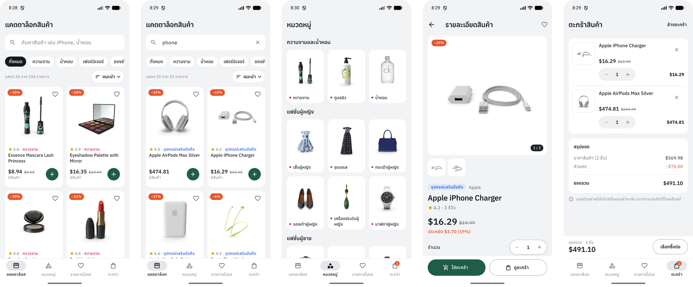
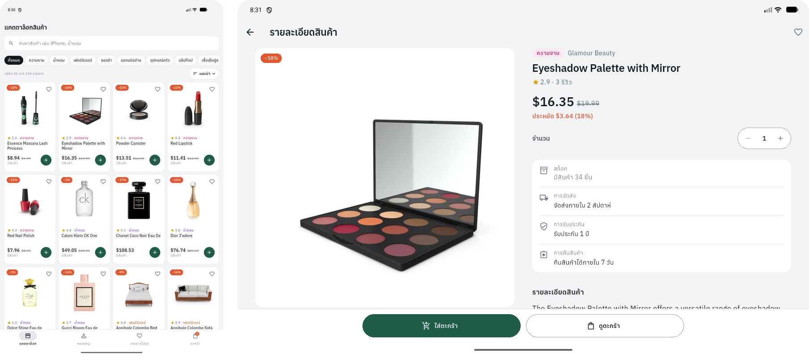

# Product Catalog (Flutter)

A Flutter product catalog backed by the [DummyJSON products API](https://dummyjson.com/docs/products):
a product list with pagination and a product detail page, built with
**Riverpod** and **Dio**, with layouts for phones and tablets. The UI is in Thai.

**Try it:** download the debug APK from
[Releases](https://github.com/pawarit-ming/flutter-product-catalog/releases/latest).

**Phone** — catalog · search · categories · product detail · cart



**Tablet** — portrait catalog (4 columns) · landscape two-pane product detail



## Requirements checklist

| # | Requirement | Where |
|---|---|---|
| 1 | List shows image, name, price | `products/presentation/widgets/product_card.dart` |
| 2 | Tap opens product detail | `ProductDetailScreen.open(context, productId)` |
| 3 | Riverpod | `productListProvider` (AsyncNotifier), `productDetailProvider` (FutureProvider.family), `catalogQueryProvider`, `categoriesProvider`, `dioProvider` / `productRepositoryProvider` |
| 4 | Dio | `products/data/product_repository.dart` (`DioProductRepository`) |
| 5 | Loading / Error / Empty | Skeleton grid on first load; error views with Retry; empty states that match the search or category |
| 6 | Pull-to-refresh | `RefreshIndicator` + `AlwaysScrollableScrollPhysics` (also works on empty and error states) |
| 7 | Pagination / Load More | "โหลดเพิ่มเติม" button with spinner, Retry, page counter and progress bar |
| 8 | Mobile and tablet | 1–4 columns from the real width; navigation rail and two-pane detail from 840 dp |
| 9 | UI / State / Repository split | `presentation/` / `application/` / `data/` in each feature |
| 10 | No hardcoded products | Everything comes from the API; fake data exists only under `test/` |

## Versions

| Tool | Version |
|---|---|
| Flutter | 3.41.0 (stable) |
| Dart | 3.11.0 (`pubspec.yaml` requires ^3.10.7) |
| flutter_riverpod / riverpod | 3.3.2 |
| dio | 5.11.1 |
| intl | 0.20.2 (pinned by Flutter localizations) |
| shared_preferences | 2.5.5 |
| cached_network_image | 3.4.1 |

Exact dependency versions are pinned in `pubspec.lock`.

## Getting started

```bash
flutter pub get
flutter run
```

Checks:

```bash
flutter analyze
flutter test
```

Tests use a fake repository and a fake Dio adapter, so they need no internet.

## Architecture

```
lib/
  main.dart, app.dart            ProviderScope, Thai MaterialApp and theme
  core/                          Dio provider, errors, formatting, storage, theme
  features/
    products/
      data/                      Product model, ProductRepository (Dio)
      application/               Riverpod providers: query, product list (pagination), detail, categories
      presentation/              catalog screen, detail screen, widgets
    categories/                  Categories tab
    cart/, wishlist/             saved on the device
    home/                        bottom bar / navigation rail shell
```

Flow: **UI → Riverpod providers → ProductRepository → Dio → REST API**

- **UI** only renders state and forwards user actions; it never touches Dio.
- **State**: `productListProvider` watches `catalogQueryProvider`. Changing
  the search, category or sort reloads from page one and cancels the
  previous request.
- **Repository** picks the endpoint (`/products`, `/products/search`,
  `/products/category/{slug}`), validates the JSON, and turns every failure
  into an `AppException` (timeout, network, not found, server, invalid data)
  with a Thai message. Users never see raw exceptions.
- Dio and the repository are provided through Riverpod, so tests replace them
  with `overrideWithValue`.

## Pagination and refresh

- The API takes `limit` / `skip`; the page size is 20. The next offset and
  `hasMore` come from the response's `total`.
- Load More is ignored while another load or refresh is running. On failure
  the cursor does not move, so Retry asks for the same page again. Duplicate
  IDs are never appended.
- A slow request from before a refresh or a query change can never add stale
  items (each request is tagged with a generation and its `CancelToken` is
  cancelled).
- Refresh keeps the current items on screen. On failure the old list stays
  and a SnackBar explains the error.

## Responsive layout

| Available width | Behaviour |
|---|---|
| Any | 1–4 columns computed from the real width (minimum card width 150 dp) |
| ≥ 840 dp | Navigation rail instead of the bottom bar; detail page shows gallery and info side by side |
| > 1200 dp | Content centred and capped at 1200 dp |

Widget tests check for overflow on the catalog, detail and cart screens at
360×800, 800×1280 and 1280×800 with text scale 1.0 and 1.5.

## Testing

`flutter analyze` reports no issues and all 110 tests pass. They cover the
product model and its validation, the repository (endpoints, pagination,
error mapping) with a fake Dio adapter, the product list state (pagination,
refresh, stale requests), and the main screens as widget tests (loading,
error, empty, pull-to-refresh, Load More, opening a product and coming back).

## Extra features

- Search, category filters and sorting
- Categories tab with a photo for each category
- Wishlist and cart saved on the device
- Thai category names and shipping, warranty and return-policy text

## Assumptions

- The API has no currency field, so prices are shown in USD.
- There is no checkout; the cart is a local demo.
- DummyJSON data can change, so nothing depends on specific IDs or counts.
